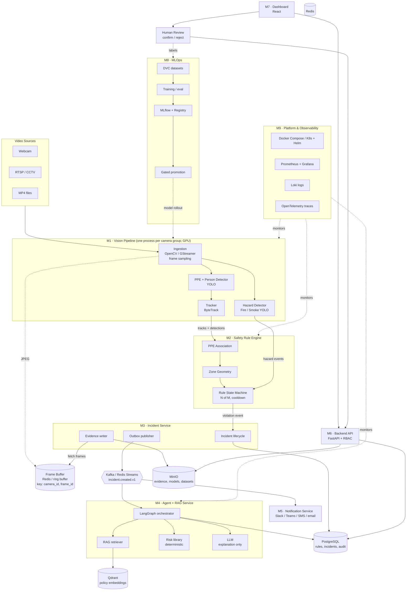

# VisionGuard AI – Improved Architecture (v2)

Advisory factory safety monitoring: Computer Vision + deterministic rules + Agentic AI/RAG + MLOps.
**The system is advisory only. It never controls machinery. LLMs never make safety-critical decisions.**

---

## 1. What changed from v1

| # | Change | Reason |
|---|--------|--------|
| 1 | Added **Milestone 0** (dataset, labeling, baseline metrics, targets) | Model quality on gloves/goggles is the biggest project risk |
| 2 | Merged ingestion + detection + tracking into one **Vision Pipeline** (stages, not microservices) for the MVP | Avoids per-frame network hops; split later only if profiling justifies it |
| 3 | Replaced MJPEG-over-HTTP as the internal transport with in-process queues (MVP) / gRPC or Redis Streams (production) | MJPEG has no replay or backpressure; keep it only as a debug/preview endpoint |
| 4 | Explicit **PPE-to-person association** and **zone geometry** (polygons, foot-point) | Rule accuracy depends on it |
| 5 | Rule **state machine** (N-of-M frames, cooldown, dedup) | Prevents flicker and duplicate incidents |
| 6 | Separate **Fire/Smoke model** with its own thresholds | Different data, different failure costs |
| 7 | Added **Notification service** and **Human review / feedback loop** | Supervisors must actually be told; labels feed retraining |
| 8 | Risk scoring is a **deterministic library**, not an LLM step or a service | Auditable, testable |
| 9 | Outbox pattern, schema versioning, idempotency keys for events | No lost or duplicated incidents |
| 10 | Added **Evaluation** (agent, RAG, end-to-end replay) and **Non-functional requirements** (SLOs, privacy, security) | Missing in v1 |
| 11 | Observability and testing start in Milestone 1, not Milestone 8 | Debuggability from day one |

---

## 2. Overall architecture diagram

### 2.1 Mermaid diagram



### 2.2 ASCII fallback

```
 Webcam / RTSP / MP4
        │
        ▼
┌───────────────────────────────────────────────┐
│ M1 VISION PIPELINE (GPU)                      │
│ Ingestion → PPE/Person YOLO → ByteTrack       │
│          └→ Fire/Smoke YOLO                   │
└───────┬──────────────────────┬────────────────┘
        │ JPEG                 │ tracks + detections
        ▼                      ▼
  Frame Buffer         M2 SAFETY RULE ENGINE
 (Redis/ring)          association → zones → state machine
        ▲                      │ violation event
        │ fetch by             ▼
        │ camera_id,    M3 INCIDENT SERVICE ──► PostgreSQL
        │ frame_id      evidence ► MinIO
        └───────────────  outbox ► Kafka/Redis Streams
                                   │ incident.created.v1
                    ┌──────────────┼───────────────┐
                    ▼              ▼               ▼
            M4 AGENT + RAG   M5 NOTIFICATIONS   M6 BACKEND API ◄── M7 DASHBOARD
            LangGraph        Slack/Teams/SMS    FastAPI+RBAC       React
            Qdrant, Risk lib                                          │
            LLM (explain)                                       Human review
                                                                (confirm/reject)
                                                                      │ labels
                                                                      ▼
                                              M8 MLOPS: DVC → train → MLflow → gated registry → rollout
 Cross-cutting: M9 Docker/K8s/Helm/ArgoCD · Prometheus/Grafana/Loki/OTel · Secrets · RBAC
```

---

## 3. Three data paths (keep them separate)

1. **Video path** (high volume): camera → in-process queue → detector → tracker → rule engine. JPEG frames go to the frame buffer, never through Kafka.
2. **Event path** (low volume, structured): incident → outbox → Kafka/Redis Streams → agent, notifications, API.
3. **Engineering path**: DVC/MLflow/CI-CD/observability.

---

## 4. Module specifications

### Milestone 0 – Dataset & Baseline (not a runtime module)

| | |
|---|---|
| **Purpose** | Prove the vision model can detect the required classes before building anything on top |
| **Input** | Public datasets (Roboflow Universe PPE sets, SH17, Construction-PPE, fire/smoke sets), 200–500 frames from your own cameras or webcam |
| **Output** | Versioned dataset (DVC), class taxonomy, baseline model, metrics report, target table |
| **Targets (example)** | person mAP50 ≥ 0.90; helmet/vest recall ≥ 0.90; gloves/goggles recall ≥ 0.70 (decide early if realistic); fire/smoke recall ≥ 0.85 |
| **Tools** | CVAT or Label Studio (labeling), Roboflow (dataset mgmt/augmentation), DVC, MLflow |
| **Libraries** | `ultralytics`, `torch`, `torchvision`, `albumentations`, `supervision`, `pycocotools`, `fiftyone` (dataset inspection) |

Class taxonomy: `person, helmet, no_helmet, vest, no_vest, gloves, no_gloves, goggles, mask, forklift, truck`. Fire/smoke trained as a separate model.

---

### M1 – Vision Pipeline (Ingestion + Detection + Tracking)

Implemented as **stages in one process**. Split into services only after profiling.

#### M1a Ingestion stage
| | |
|---|---|
| **Input** | Webcam index, RTSP URL, MP4 path, and a camera config (`camera_id`, target FPS, resolution) |
| **Processing** | Capture, drop-oldest backpressure, sample at ~10 FPS, assign `frame_id`, write JPEG to frame buffer (ring buffer of last ~30 s), reconnect on stream loss |
| **Output (internal)** | `FramePacket{camera_id, frame_id, ts, ndarray, width, height}` and a JPEG in the buffer |
| **Output (debug)** | `GET /cameras/{id}/stream` (MJPEG), `GET /cameras/{id}/frames/{frame_id}` (JPEG), `GET /health` |
| **Tools** | FFmpeg, GStreamer (optional, for RTSP/hardware decode), Redis |
| **Libraries** | `opencv-python`, `numpy`, `fastapi`, `uvicorn`, `pydantic`, `redis`, `turbojpeg` (fast encode), `av` (PyAV, optional) |

#### M1b Detection stage
| | |
|---|---|
| **Input** | `FramePacket` |
| **Output** | `DetectionResult` |

```json
{
  "schema_version": "1.0",
  "camera_id": "CAM_001",
  "frame_id": 1024,
  "timestamp": "2026-10-31T10:30:00Z",
  "model_version": "ppe-yolo-v1",
  "inference_ms": 18.4,
  "detections": [
    {"class": "person", "confidence": 0.97, "bbox": [120, 80, 350, 600]},
    {"class": "helmet", "confidence": 0.94, "bbox": [180, 90, 230, 140]},
    {"class": "no_gloves", "confidence": 0.71, "bbox": [300, 400, 340, 450]}
  ]
}
```
Hazard model (fire/smoke) runs in parallel with its own confidence thresholds and emits `hazard_detections`.

| | |
|---|---|
| **Tools** | NVIDIA GPU + CUDA, TensorRT / ONNX Runtime for optimization, optionally Triton Inference Server or DeepStream |
| **Libraries** | `ultralytics`, `torch`, `onnx`, `onnxruntime-gpu`, `tensorrt`, `supervision` |

#### M1c Tracking stage
| | |
|---|---|
| **Input** | `DetectionResult` (person and machinery classes tracked; PPE kept as per-frame detections) |
| **Output** | `TrackResult` |

```json
{
  "schema_version": "1.0",
  "camera_id": "CAM_001",
  "frame_id": 1024,
  "timestamp": "2026-10-31T10:30:00Z",
  "tracks": [
    {"track_id": "CAM_001-T017", "class": "person", "confidence": 0.97,
     "bbox": [120, 80, 350, 600], "age_frames": 42}
  ],
  "ppe_detections": [{"class": "helmet", "confidence": 0.94, "bbox": [180, 90, 230, 140]}]
}
```
Track IDs are anonymous and scoped to camera + session. Cross-camera re-identification is out of scope (privacy).

| | |
|---|---|
| **Tools** | – |
| **Libraries** | `ultralytics` (built-in ByteTrack/BoT-SORT) or `boxmot`, `supervision.ByteTrack`, `filterpy`, `scipy` (Hungarian matching), `lap` |

---

### M2 – Safety Rule Engine

Deterministic, configurable, auditable. Pure logic, so it is heavily unit-tested.

| | |
|---|---|
| **Input** | `TrackResult` stream, hazard detections, zone and rule config from PostgreSQL (cached, hot-reloaded) |
| **Association** | PPE-to-person by containment/IoU per PPE type, e.g. helmet center inside the top 25% of the person box; gloves near the lower-arm region; vest within the torso region. Each PPE type has its own region and threshold |
| **Zone logic** | Per-camera polygons; a person's position is the **foot-point** (bottom-center of the box), tested with point-in-polygon |
| **State machine** | `OBSERVING → SUSPECTED → CONFIRMED → COOLDOWN`; confirm when N of the last M frames show the violation (e.g. 8 of 10); cooldown per (track, rule) to prevent duplicates; a "not visible/occluded" state does not count as a violation |
| **Rule config** | |

```yaml
zone: welding
camera_id: CAM_001
polygon: [[100,200],[900,200],[900,700],[100,700]]
rules:
  - id: R-PPE-HELMET
    type: PPE_REQUIRED
    object: person
    required_item: helmet
    confirm: {n: 8, m: 10}
    cooldown_s: 60
  - id: R-PPE-GLOVES
    type: PPE_REQUIRED
    object: person
    required_item: gloves
    confirm: {n: 8, m: 10}
    cooldown_s: 60
  - id: R-RESTRICTED
    type: RESTRICTED_ENTRY
    allowed: false
```

**Output** – `ViolationEvent`:

```json
{
  "schema_version": "1.0",
  "event_id": "evt-9f3a...",
  "rule_id": "R-PPE-GLOVES",
  "event_type": "PPE_VIOLATION",
  "camera_id": "CAM_001",
  "track_id": "CAM_001-T017",
  "zone": "WELDING",
  "missing_ppe": ["gloves"],
  "confidence": 0.86,
  "first_seen_frame": 1016,
  "confirmed_frame": 1024,
  "evidence_frames": [1016, 1020, 1024],
  "timestamp": "2026-10-31T10:30:00Z"
}
```

| | |
|---|---|
| **Tools** | PostgreSQL, Redis (state/cooldowns) |
| **Libraries** | `shapely` (geometry), `numpy`, `pydantic`, `pyyaml`, `sqlalchemy`, `asyncpg`, `alembic` (migrations), `transitions` (state machine), `pytest`, `hypothesis` |

---

### M3 – Incident Service

| | |
|---|---|
| **Input** | `ViolationEvent` (in-process call, or an event-bus message) |
| **Processing** | Create incident (idempotency key = `rule_id + track_id + first_seen_frame`); fetch evidence frames from the frame buffer by `camera_id, frame_id`; optionally blur faces; draw boxes; save to MinIO; write the incident and outbox row in **one DB transaction**; a publisher relays outbox rows to the bus |
| **Lifecycle** | `OPEN → UNDER_REVIEW → CONFIRMED / FALSE_POSITIVE → RESOLVED` |
| **Output** | Incident record + event `incident.created.v1` |

```json
{
  "schema_version": "1.0",
  "incident_id": "INC-000123",
  "event_type": "PPE_VIOLATION",
  "track_id": "CAM_001-T017",
  "camera_id": "CAM_001",
  "zone": "WELDING",
  "missing_ppe": ["gloves"],
  "evidence_uris": ["s3://evidence/INC-000123/0.jpg", "s3://evidence/INC-000123/1.jpg"],
  "status": "OPEN",
  "created_at": "2026-10-31T10:30:01Z"
}
```

| | |
|---|---|
| **Tools** | PostgreSQL, MinIO, Kafka (or Redis Streams / NATS for MVP), Schema Registry (optional) |
| **Libraries** | `fastapi`, `sqlalchemy`, `asyncpg`, `alembic`, `minio` or `boto3`, `aiokafka` / `confluent-kafka`, `redis`, `opencv-python` (annotation/blur), `pydantic`, `tenacity` (retries) |

Failure handling: retries with backoff, dead-letter topic `incident.dlq`, health endpoints.

---

### M4 – Agent + RAG Service

Runs **only on confirmed incidents**, never per frame. One LangGraph orchestrator.

| | |
|---|---|
| **Input** | `incident.created.v1` event |
| **Graph** | `load_incident → retrieve_policy (RAG) → get_history → compute_risk (deterministic lib) → draft_explanation (LLM) → validate_output → persist` |
| **Tools exposed to the agent** | `search_safety_policy()`, `get_previous_incidents()`, `get_machine_details()`, `compute_risk_score()` (read-only) |
| **Guardrails** | Structured JSON output validated by schema; every recommendation must cite a retrieved policy chunk; if retrieval confidence is low, return "needs human review" instead of guessing; no tool can send commands to machinery |

**RAG ingestion pipeline**:
```
PDF/DOCX → loader → text extraction → chunking (by section, 500–800 tokens, overlap 80)
  → embedding → Qdrant (with metadata: doc, section, page, version)
```
Retrieval: hybrid (dense + BM25) with reranking.

**Output** – `IncidentAnalysis`:

```json
{
  "incident_id": "INC-000123",
  "risk": {"score": 8, "severity": "HIGH", "factors": [
    {"factor": "missing_gloves_in_welding_zone", "points": 4},
    {"factor": "repeat_violation_24h", "points": 2},
    {"factor": "heavy_machinery_nearby", "points": 2}]},
  "explanation": "A worker entered the welding area without gloves, which is required by the welding PPE policy.",
  "recommendations": [
    "Notify the shift supervisor",
    "Verify glove availability at the welding station entrance"
  ],
  "citations": [{"doc": "PPE-Policy-v3.pdf", "section": "4.2 Welding", "page": 12, "score": 0.83}],
  "needs_human_review": false,
  "model": "gpt-4o / llama-3.1-70b",
  "prompt_version": "v4"
}
```

| | |
|---|---|
| **Tools** | Qdrant, an LLM endpoint (hosted API, or Ollama / vLLM for local Llama), LangSmith or Langfuse (tracing) |
| **Libraries** | `langgraph`, `langchain`, `langchain-community`, `langchain-qdrant`, `qdrant-client`, `sentence-transformers` (e.g. `bge-small-en`), `rank-bm25`, `unstructured` / `pypdf` / `python-docx` (loaders), `tiktoken`, `openai` or `ollama`, `pydantic`, `langfuse` |

**Risk library** (a plain Python package, not a service): configurable points table in YAML, validated with safety professionals, unit-tested.

---

### M5 – Notification Service

| | |
|---|---|
| **Input** | `incident.created.v1` and `incident.analysed.v1` |
| **Processing** | Severity routing (HIGH → immediate to supervisor; LOW → daily digest), dedup, rate limiting, escalation if not acknowledged within X minutes |
| **Output** | Message with thumbnail and a deep link to the dashboard; delivery log |
| **Tools** | Slack/Teams webhooks, Twilio (SMS), SMTP |
| **Libraries** | `slack-sdk`, `httpx`, `twilio`, `aiosmtplib`, `jinja2`, `aiokafka` |

---

### M6 – Backend API

| | |
|---|---|
| **Input** | REST requests from the dashboard |
| **Endpoints** | `GET /incidents`, `GET /incidents/{id}`, `POST /incidents/{id}/review` (confirm/reject + comment), `GET/PUT /zones`, `GET/PUT /rules` (audited), `GET /analytics/compliance`, `GET /cameras` |
| **Output** | JSON, plus signed URLs for evidence images |
| **Security** | OIDC login (Keycloak/Auth0), RBAC roles (viewer, supervisor, admin), audit log of rule changes and incident access |
| **Tools** | PostgreSQL, MinIO, Keycloak |
| **Libraries** | `fastapi`, `sqlalchemy`, `pydantic-settings`, `python-jose` / `authlib`, `fastapi-pagination`, `structlog` |

KPI definitions must be explicit: "PPE compliance %" is defined as *compliant person-visits / total person-visits per shift*, not a loose frame ratio.

---

### M7 – Dashboard

| | |
|---|---|
| **Input** | Backend API, live incident updates via WebSocket/SSE |
| **Views** | Live incident feed, evidence viewer with bounding boxes, review queue (confirm/reject), zone editor (draw polygons on a camera still), trends, repeat offenders by zone, camera health |
| **Output** | Web UI; every review click becomes a labeled sample for retraining |
| **Tools** | Node.js 20+, Vite |
| **Libraries** | `react`, `typescript`, `@tanstack/react-query`, `react-router`, `recharts` or `echarts`, `tailwindcss`, `konva` / `react-konva` (polygon drawing), `zustand` |

---

### M8 – MLOps

| | |
|---|---|
| **Input** | Versioned datasets, reviewed production incidents (false positives are hard negatives; confirmed misses are new positives) |
| **Pipeline** | `DVC dataset → train → evaluate on a frozen golden test set → log to MLflow → register → staging → shadow/canary → production` |
| **Promotion gates** | Per-class recall/precision above targets; no regression vs. the current model; latency under budget on target hardware; replay-test pass; manual approval |
| **Output** | Versioned model (`.pt`, `.onnx`, `.engine`), evaluation report, rollback pointer |
| **Tools** | DVC with MinIO remote, MLflow server, GitHub Actions, Evidently (drift) |
| **Libraries** | `dvc[s3]`, `mlflow`, `ultralytics`, `evidently`, `optuna` (optional), `onnx`, `onnxruntime`, `pytest` |

---

### M9 – Platform, Security & Observability

| Area | Tools | Libraries / config |
|------|-------|--------------------|
| Containers | Docker, Docker Compose (MVP) | multi-stage Dockerfiles, NVIDIA Container Toolkit |
| Orchestration (optional polish) | Kubernetes (k3s/kind locally), Helm, ArgoCD, NGINX Ingress | Helm charts per service |
| CI/CD | GitHub Actions | `ruff`, `mypy`, `pytest`, `pre-commit`, `trivy` (image scan) |
| Metrics | Prometheus, Grafana, DCGM exporter (GPU) | `prometheus-client` |
| Logs | Loki + Promtail | `structlog` (JSON logs with `camera_id`, `incident_id`) |
| Tracing | OpenTelemetry Collector, Tempo or Jaeger | `opentelemetry-sdk`, `opentelemetry-instrumentation-fastapi` |
| Secrets | Vault / Kubernetes secrets / `.env` for dev | RTSP credentials never in code or images |
| Messaging | Kafka (or Redis Streams / NATS for MVP) | `aiokafka` |

Key metrics: dropped frames, FPS per camera, inference p95 latency, active tracks, track switches, violations confirmed vs. rejected (precision), end-to-end latency (camera→alert), LLM latency/tokens/errors, retrieval hit rate, incident resolution time.

---

## 5. Non-functional requirements

| Area | Target (initial, tune later) |
|------|------------------------------|
| End-to-end latency | Camera → alert < 2–3 s at p95 |
| Throughput | N cameras per GPU (benchmark in Milestone 1; plan capacity from it) |
| Availability | Vision pipeline auto-restarts; the camera reconnect loop never crashes the service |
| False-alarm budget | e.g. < 1 false incident per camera per shift (measured via human review) |
| Privacy | Anonymous track IDs, optional face blurring, evidence retention policy (e.g. 30–90 days), access-controlled evidence, DPIA / labor-law review (GDPR, India DPDP Act) |
| Security | Secrets manager, TLS/mTLS between services, RBAC, audit log |
| Safety stance | Advisory only; human review for uncertain incidents; no machine control |
| Reliability | Retries, DLQ, outbox pattern, health checks, model rollback |

---

## 6. Evaluation & testing strategy

| Layer | What to test | How |
|-------|--------------|-----|
| Detection | Per-class precision/recall/mAP on a frozen test set from your camera domain | `ultralytics val`, MLflow |
| Tracking | ID switches, MOTA/IDF1 on annotated clips | `motmetrics` / `TrackEval` |
| Rule engine | Association, zones, state machine, cooldown | `pytest`, `hypothesis` property tests (pure logic) |
| End-to-end | Recorded video with ground-truth violations replayed in CI; assert expected incidents are produced | Replay harness |
| RAG | recall@k, citation correctness on a golden question set | `ragas` or custom scripts |
| Agent | Groundedness, schema validity, policy-citation accuracy; low-confidence fallback | Golden incidents, LLM-as-judge + human spot checks |
| Contracts | Event schemas between services | `pydantic` + JSON Schema, `schemathesis` |
| Load | Multi-camera stream, API | `locust`, synthetic RTSP via `ffmpeg` |

---

## 7. Tech stack summary

| Layer | Choice |
|-------|--------|
| Language | Python 3.11+, TypeScript (frontend) |
| Vision | OpenCV, Ultralytics YOLO, PyTorch, ONNX/TensorRT, ByteTrack |
| Geometry/rules | Shapely, Pydantic, `transitions` |
| Messaging | Kafka (portfolio) or Redis Streams / NATS (MVP) |
| Datastores | PostgreSQL, Redis, MinIO, Qdrant |
| AI | LangGraph, LangChain, sentence-transformers, Llama (Ollama/vLLM) or GPT |
| MLOps | DVC, MLflow, Evidently |
| API/UI | FastAPI, React + TypeScript |
| Ops | Docker Compose → K8s/Helm/ArgoCD, GitHub Actions, Prometheus, Grafana, Loki, OpenTelemetry |

---

## 8. Revised roadmap

| Milestone | Scope | Exit criteria |
|-----------|-------|---------------|
| **0** | Dataset, labeling, baseline model, targets, project skeleton, logging + metrics scaffold | Baseline metrics report; go/no-go on glove/goggle classes |
| **1** | Vertical slice: webcam → detection → tracking → console / annotated MJPEG preview | Real-time FPS measured; latency baseline |
| **2** | Rule engine: association, zones, state machine, unit tests | Replay clip produces correct violations; tests > 90% on rule logic |
| **3** | Incident service: Postgres, MinIO evidence, outbox, event bus | Violation → incident with evidence image |
| **4** | Thin dashboard + API + human review + notifications | Webcam → incident → dashboard → review (the demo works end to end) |
| **5** | RAG + LangGraph agent + deterministic risk library + evaluation sets | Cited, schema-valid analyses; golden-set scores recorded |
| **6** | MLOps: DVC/MLflow, gated promotion, retraining from review labels, drift monitoring | One full retrain-and-promote cycle |
| **7** | Fire/smoke model, hardening, Grafana dashboards, tracing | Hazard alerts, SLO dashboard |
| **8** (optional) | Kubernetes, Helm, ArgoCD | One-command GitOps deploy |

### Final demo script
1. A worker appears on the webcam; YOLO detects the person and PPE.
2. ByteTrack assigns an anonymous ID.
3. The worker steps into a configured zone without gloves.
4. The rule engine confirms the violation after N-of-M frames.
5. Evidence is saved to MinIO and the incident is created once (no duplicates).
6. The agent retrieves the welding procedure via RAG and the risk library scores severity.
7. The LLM writes a cited explanation; the supervisor gets a Slack/Teams message.
8. The dashboard shows the incident; the supervisor confirms it and the label goes to the retraining set.
9. Grafana shows FPS, latency, and incident metrics.

---

## 9. Suggested repository layout

```
visionguard/
├── services/
│   ├── vision_pipeline/     # ingestion, detector, tracker
│   ├── rule_engine/         # association, zones, state machine
│   ├── incident_service/
│   ├── agent_rag_service/
│   ├── notification_service/
│   └── backend_api/
├── libs/
│   ├── schemas/             # pydantic event contracts (versioned)
│   ├── risk/                # deterministic risk scoring
│   └── common/              # logging, metrics, config
├── frontend/dashboard/
├── ml/                      # dvc.yaml, training, eval, golden sets
├── knowledge_base/          # safety documents + ingestion scripts
├── deploy/                  # docker-compose.yml, helm/, argocd/
├── tests/                   # unit, contract, replay, load
└── docs/
```
